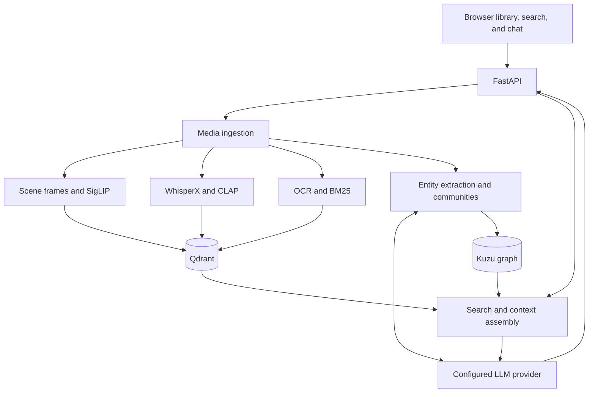

# DSpro · Multimodal Video RAG

Search a media library by what is shown, spoken, or heard, then ask questions about the relevant material. DSpro combines video ingestion, multimodal retrieval, and an LLM-backed chat interface in a Python application.

**Status:** Experimental application with implemented ingestion, search, chat, and graph workflows. Running inference requires model assets that are not included in this repository.

## What it does

- Ingests video, audio, images, and PDFs through a browser interface with progress reporting.
- Splits video into scenes, transcribes speech with WhisperX, and extracts English and Arabic on-screen text with EasyOCR.
- Searches visual embeddings, acoustic embeddings, and transcript/OCR text in Qdrant, returning media references and timestamps.
- Answers questions over selected media using retrieved text and a configurable LLM provider.
- Extracts entities and relationships into a Kuzu graph; uses NetworkX community detection and LLM summaries for graph-assisted retrieval.
- Organizes uploaded media into folders and supports local LM Studio/Ollama servers or configured cloud providers.

## Architecture



The browser is served by FastAPI. Compose starts the backend and Qdrant; the LLM server runs separately. Named Docker volumes preserve media, vector data, and graph data.

## Setup

### 1. Prepare the environment

- Install Docker with Compose and NVIDIA GPU support. The supplied Compose configuration reserves one NVIDIA GPU; the image uses a PyTorch/CUDA runtime.
- Allow disk space for the container image, several model caches, and uploaded media. No minimum VRAM or throughput has been benchmarked in this repository.
- Run an LLM server such as LM Studio on the host and load a model that fits your hardware. The model identifier must match the identifier exposed by that server.

```bash
git clone https://github.com/RAMZI0TO99/DSpro.git
cd DSpro
```

Copy the supplied `.env.example` to `.env` in the repository root; Compose requires the file even when no API key is used. The template contains empty optional credential fields, so local LM Studio and Ollama need no keys.

```powershell
# PowerShell; creates the file only if it does not already exist
if (-not (Test-Path .env)) { Copy-Item .env.example .env }
```

On Linux/macOS, use `[ -f .env ] || cp .env.example .env` to preserve an existing configuration.

### 2. Supply the model assets

The Dockerfile copies a local `models/` directory into the image. A fresh clone does **not** contain that directory, and the build does not provision these inference models. Populate the caches using the corresponding libraries in a compatible environment before building; there is currently no bundled download script or model archive.

| Component | Model or assets used by the source | Local location |
|---|---|---|
| Visual retrieval | OpenCLIP `ViT-B-16-SigLIP`, `webli` weights; `google/siglip-base-patch16-256` tokenizer | `models/huggingface/` |
| Acoustic retrieval | `laion/clap-htsat-unfused` model and processor | Hugging Face cache, or an exported model directory at `models/clip/` |
| Text retrieval | FastEmbed `Qdrant/bm25` and `sentence-transformers/paraphrase-multilingual-MiniLM-L12-v2` | `models/fastembed/` |
| Speech transcription | WhisperX `base`, its runtime assets, and alignment models for the media language | `models/huggingface/` and `models/torch/`, as required by the loaders |
| OCR | EasyOCR detector and recognition weights for `en` and `ar` | `models/easyocr/model/` |

Keep the Hugging Face cache layout intact, including its `hub/` directory. EasyOCR is configured with `download_enabled=False`, so missing OCR weights must be supplied explicitly. WhisperX first attempts float16 inference and falls back to int8.

Some components select CPU when CUDA is unavailable, but the supplied Compose GPU reservation and EasyOCR GPU setting make this a GPU-oriented setup. A CPU-only installation is not documented or validated here.

### 3. Configure the LLM and start the services

The defaults in [docker-compose.yml](docker-compose.yml) are:

| Setting | Default |
|---|---|
| `LLM_PROVIDER` | `local` (LM Studio) |
| `LLM_BASE_URL` | `http://host.docker.internal:1234/v1` |
| `LLM_MODEL` | `Llama-3.2-3B-Instruct-Q4_K_M` |
| `QDRANT_URL` | `http://qdrant:6333` |

Edit the explicit `environment:` values in Compose to change these defaults. Values listed there override the same names in `.env`. API keys for a selected provider can be supplied through `.env`, such as `OPENAI_API_KEY` or `GEMINI_API_KEY`; a local server does not need either key.

```bash
docker compose up --build
```

Open the application at **http://localhost:8000/** and the API reference at **http://localhost:8000/docs**.

Use **Settings** in the UI to select a provider, base URL, and model. For Ollama on the host, the configured OpenAI-compatible endpoint is `http://host.docker.internal:11434/v1`; enter the exact model name you have installed. From inside the backend container, `localhost` refers to that container.

UI settings are saved to `settings.json` and take precedence over environment defaults on startup. That file is not mounted in a named volume, so container recreation can discard UI changes. Restart the backend after changing providers before relying on graph extraction, which keeps its own settings reference.

### Configuration boundaries

The current application is intended for a trusted local environment. It has no authentication layer, and its settings endpoint returns the configured API key. Do not expose the backend or Qdrant publicly as configured.

Local LLM selection keeps generation on that server; selecting a remote provider sends prompts and retrieved text to it. Fully offline operation is not guaranteed: application startup resets `HF_HUB_OFFLINE` despite the Compose setting, and the frontend references external font and graph-script resources.

## Example workflow

1. Start with a short MP4 containing speech and a visible object or slide.
2. Click **+ Files**, upload it, and wait for ingestion to finish. The upload endpoint enforces a 2 GiB per-file limit and checks the MIME type.
3. Search for a phrase or visible event, then inspect the returned snippet and timestamp against the source media.
4. Select the relevant media and ask a question whose answer appears in the transcript or on-screen text.
5. Inspect the graph view to explore extracted entities and relationships; treat these as model-generated interpretations.

For an API client, send this JSON body to `POST /search` after ingesting media:

```json
{
  "query": "a person explaining a chart",
  "top_k": 5
}
```

`top_k` must be a non-negative integer and defaults to 5. Negative counts are rejected during request validation.

This is an example request, not a recorded result. Search responses include media IDs, timestamps, transcript snippets, and retrieval scores. The response field is named `hybrid_rrf_score`, but the current implementation merges capped scores by maximum; it does not implement reciprocal rank fusion.

## Implementation evidence

| Area | Source |
|---|---|
| Media processing and vector storage | [ingestion.py](ingestion.py) |
| Model loading and acoustic embeddings | [vector_search.py](app/services/vector_search.py), [audio_extractor.py](app/services/audio_extractor.py) |
| Upload, retrieval, chat, and settings API | [routes.py](app/api/routes.py) |
| Entity extraction and graph retrieval | [graph_service.py](app/services/graph_service.py) |
| Browser workflows | [Frontend/](Frontend/) |

## Limitations and validation

- Retrieval quality, latency, and answer accuracy have no published benchmark or reference evaluation dataset in this repository.
- Context packing uses character limits rather than the selected model's exact tokenizer and context window. Answers and graph summaries still require checking against the original media.
- Speech alignment may fall back to English when a language-specific model cannot load; this can affect timestamps and transcript quality.
- Dependencies, model caches, GPU compatibility, and the separately hosted LLM must be validated together. These setup instructions are derived from source inspection; they are not a claim that a clean build or full inference run has passed.

The request-validation tests run without model assets or a running service. Install Pydantic and pytest in an isolated environment, then run:

```bash
python -m pytest tests/test_search_request.py
```
